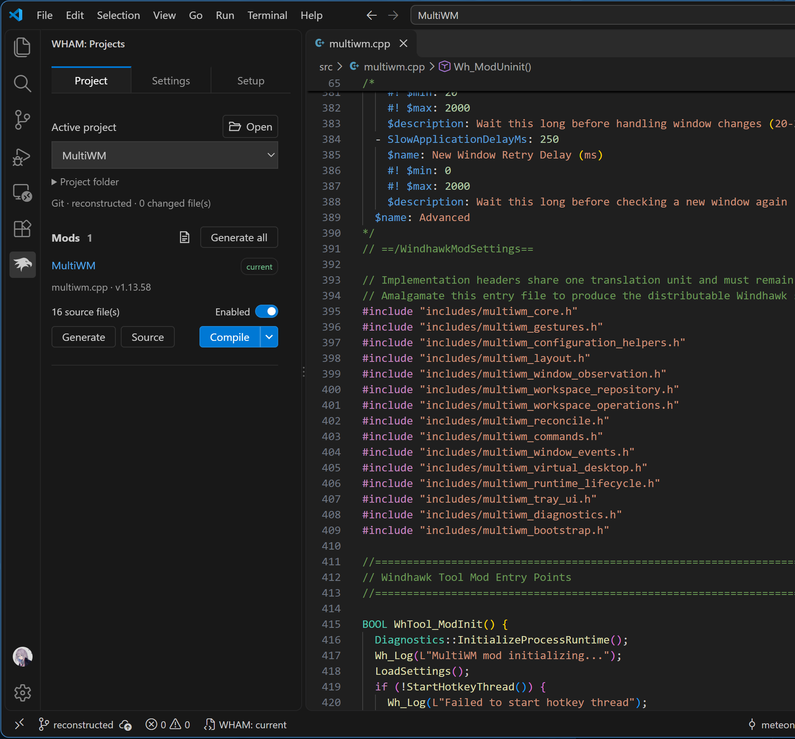
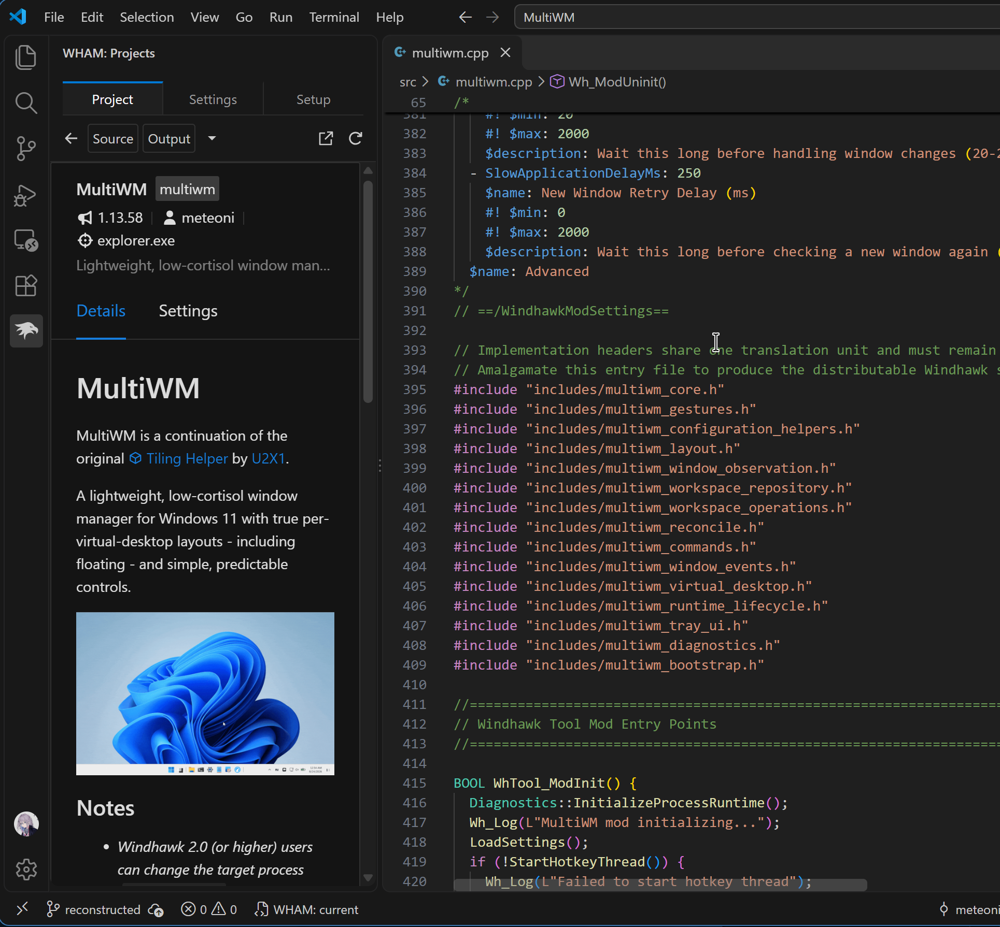

# WHAM

Windhawk Source Amalgamation for VS Code.

Write a Windhawk mod across several C++ files, then generate a single `.wh.cpp` to use in Windhawk. The output also keeps the information needed to recover those source files later.



## Getting started

1. Install the WHAM `.vsix` through **Extensions: Install from VSIX…** in VS Code.
2. Open **WHAM** in the activity bar. Choose **New project**, **Existing project**, or **Recover mods**.
3. Select your Windhawk installation and indentation. **Extension settings** holds installation and elevation preferences; **Project settings → Editor** holds local project choices and formatting.

**Open project** remembers recent folders and opens existing WHAM projects without setup prompts. Browse to select another source folder.

Keep each mod's entry `.cpp` and its local headers under `src/`. WHAM follows the includes and writes one `.wh.cpp` per entry to `output/`.

```text
src/mod.cpp + included headers → output/mod.wh.cpp
```

Output updates when you save. Use **Generate** for a single mod or **Generate all** for the project. **Settings** controls generation, compiler integration, indentation, and Git ignore rules.

New projects get `src/`, `output/`, configuration, and Git setup. Generated output and local compiler settings are ignored. **Create initial Git commit** is optional for new or recovered repositories; it uses your existing Git identity.

## Recovery

**Recover mods** rebuilds a source tree from one or more WHAM-generated files. Keep the `WHAM` boundary comments and recovery footer intact. Ordinary `.wh.cpp` files cannot recover their former project layout.

If you edit generated output, WHAM pauses regeneration so your changes aren't overwritten. Restore those edits to source or explicitly discard them before generating again.

**Compile** generates and installs the current mod in Windhawk, keeping its **Enabled** state. The first build starts disabled. The dropdown offers **Test build** without installing, **Verify syntax** for its declared architectures, and **Stop compilation** while a build is running. Click the mod name to preview its README and default settings in the sidebar. Use the external-link button beside Refresh to open Windhawk and change installed settings.



The preview works without Windhawk. Compilation and installed-mod controls need a compatible Windhawk 2.0 CLI. See the [user guide](docs/guide.md) for configuration, CLI commands, and supported C++ constructs.

Standard Windhawk installs need elevation for compilation and installed-mod changes. Choose **Windows sudo** (may require more prompts) or **gsudo** (once per VS Code session) under **Extension settings**. WHAM detects gsudo on PATH or in Scoop. **None** uses VS Code's current permissions. Saving local preferences does not change project files; **Apply editor settings** does.

## Building

Use Node.js 20 or newer, Git, and Windhawk’s Windows compiler. Set `WINDHAWK_HOME` if its installation isn’t detected.

```sh
npm ci
npm test
npm run package
```

Packaging creates a `.vsix` in this folder. Press **F5** in VS Code to launch a development host.

## License

WHAM's own code is [MIT licensed](LICENSE). The bundled Windhawk renderer, icon, and adapted syntax grammar are GPLv3; see [third-party notices](THIRD-PARTY-NOTICES.md). WHAM is an independent project.
